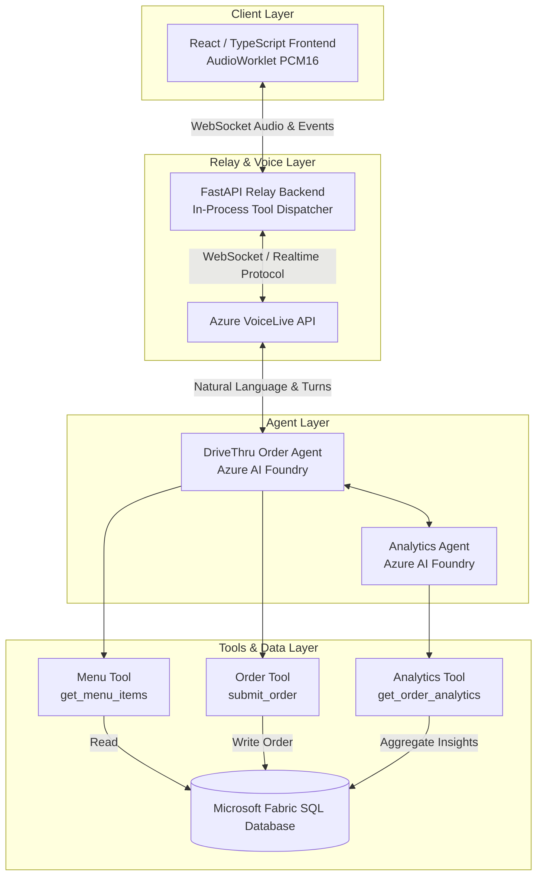
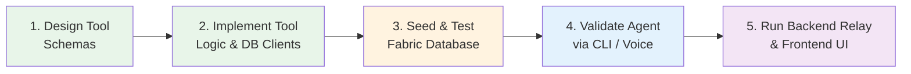

# VoiceLive API DriveThru Agent Demo

> **Agent-First Development**: Design and implement intelligent agents with robust data models and tools first, then surface their capabilities through clean web and voice interfaces.

A real-time FastFood restaurant drive-through ordering agent demonstrating the integration of **Azure VoiceLive API**, **Azure AI Foundry Agents**, and **Microsoft Fabric SQL Database**.

---

## 🎯 Architecture & Approach

This project showcases an **agent-first development methodology**:
1. **Tool & Agent Core**: Define function schemas and conversational agent logic with Azure AI Foundry.
2. **Fabric Data Layer**: Store transactional orders and analytics in Microsoft Fabric SQL Database.
3. **VoiceLive Integration**: Bi-directional audio streaming via WebSocket using the Azure OpenAI Realtime function-calling protocol.
4. **Modern UI Client**: React + TypeScript frontend utilizing AudioWorklet for low-latency PCM16 microphone capture and streaming.

### System Architecture



### Agent Development Workflow



---

## 🛠️ Tech Stack

- **Voice & Realtime**: [Azure VoiceLive API](https://learn.microsoft.com/azure/ai-services/) + AudioWorklet PCM16 streaming
- **AI Agent Platform**: [Azure AI Foundry](https://learn.microsoft.com/azure/ai-foundry/) (`azure-ai-projects` 2.0+) & Microsoft Agent Framework
- **Backend Relay**: FastAPI, Uvicorn, WebSockets (in-process function dispatching)
- **Data Storage & Analytics**: Microsoft Fabric SQL Database (`pyodbc`, `sqlalchemy`)
- **Frontend**: React 19, TypeScript, Vite, Tailwind/Vanilla CSS
- **Package & Runtime Tooling**: `uv` (ultra-fast Python package installer), Node.js

---

## 📋 Prerequisites

- **Python** 3.13 or later
- **uv** (recommended Python package manager):
  ```powershell
  powershell -c "irm https://astral.sh/uv/install.ps1 | iex"
  ```
- **Node.js** 18.x or later (for frontend development)
- **Azure CLI** (`az`): Log in via `az login`
- **Azure Subscription** with permissions to create Azure AI Foundry and Cognitive Services resources (RBAC roles: *Azure AI User*, *Cognitive Services User*)

---

## 🚀 Quick Start

### 1. Clone & Set Up Python Environment

```powershell
# Create virtual environment
uv venv

# Activate virtual environment
.venv\Scripts\Activate.ps1

# Install project with development dependencies
uv pip install -e ".[dev]"
```

### 2. Configure Environment Variables

Copy `.env.example` to `.env` and fill in your Azure AI Foundry and Fabric DB endpoints:

```powershell
Copy-Item .env.example .env
```

Key environment variables:
```env
# Azure AI Foundry project
PROJECT_ENDPOINT="https://<your-hub>.services.ai.azure.com/api/projects/<your-project>"
PROJECT_NAME="<your-project-name>"
MODEL_DEPLOYMENT_NAME="gpt-4o-realtime-preview"

# Azure VoiceLive
VOICELIVE_ENDPOINT="https://<your-hub>.services.ai.azure.com/"
VOICELIVE_API_VERSION="2026-04-10"
VOICE_NAME="en-US-Ava:DragonHDLatestNeural"

# Agent Name
AGENT_NAME="drivethru-ordering-agent"

# Microsoft Fabric Database
FABRIC_CONNECTION_STRING="Driver={ODBC Driver 18 for SQL Server};Server=...;Database=DriveThru;Encrypt=yes;Authentication=ActiveDirectoryInteractive"
```

Authentication uses `DefaultAzureCredential` (`az login` or Managed Identity) — no hardcoded API keys required.

### 3. Provision Infrastructure & Seed Database

- **Azure AI Resources**: Scripted in [`platform/aif-resources/resource-setup.azcli`](./platform/aif-resources/resource-setup.azcli).
- **Fabric Database Schema**: Run [`src/fabric/schema-setup.sql`](./src/fabric/schema-setup.sql) in your Fabric SQL Database editor.
- **Demo Data**: Populate sample menu items, synthetic customers, and initial orders:
  ```powershell
  python -m src.fabric.seed_demo_data
  ```

### 4. Create and Register the Agent

Register the agent with its tool schemas (`get_menu_items`, `submit_order`, `get_order_analytics`) in Azure AI Foundry:

```powershell
python -m src.agents.create_voice_agent
```

### 5. Run the Full Stack Locally

Run the FastAPI relay and the React frontend concurrently:

**Terminal 1 (Backend Relay):**
```powershell
uv run uvicorn src.backend.relay:app --reload --port 8000
```

**Terminal 2 (Frontend Client):**
```powershell
cd src/frontend
npm install
npm run dev
```

Open `http://localhost:5173` in your browser, click the microphone button, and talk with the DriveThru agent to place an order!

---

## 🧪 Testing

### Python Unit Tests
The backend, tool dispatchers, diagnostics, and data layers are covered by comprehensive unit tests:

```powershell
uv run --extra dev pytest tests/unit tests/test_backend_config.py tests/test_event_handlers.py tests/test_tool_dispatcher.py -v
```

### End-to-End Tests (Playwright)
Run the Playwright E2E suite (local mock, local relay, or cloud live agent):

```powershell
# Run with mock events
npm run test:e2e:mock

# Run against local relay
npm run test:e2e:relay
```

---

## 📚 Wiki & Deep-Dive Guides

Comprehensive guides for architecture, data modeling, workflows, and tools are located in the [`wiki/`](./wiki/) directory:

- [**Agent Workflow Guide**](./wiki/agent-workflow.md) — Tool calling mechanics, function execution lifecycle, and daily development loops.
- [**Architecture & Backend Decomposition**](./wiki/architecture-specs.md) — Modular breakdown of `src/backend/` (`config.py`, `tool_dispatcher.py`, `event_handlers.py`, `relay.py`).
- [**Database Guide**](./wiki/database-guide.md) — Microsoft Fabric SQL schema reference, tables, and setup scripts.
- [**Python Scripts Reference**](./wiki/python-scripts.md) — Script-first agent development, CLI commands, and validation scripts.
- [**UV Tooling Guide**](./wiki/uv-guide.md) — Virtual environment management, lockfiles, and performance benefits with `uv`.
- [**MCP Servers Overview**](./wiki/mcp-servers.md) — Recommended Model Context Protocol servers for Azure and agent workflows.
- [**Roadmap & Implementation Plan**](./wiki/roadmap.md) — Feature status, completed milestones, and upcoming tasks.
- [**MVP Planning Notes**](./wiki/planning.md) — Architecture decisions and design considerations.

---

## 🤝 Contributing

Contributions, issues, and feature requests are welcome! Feel free to check the issues page or submit a pull request.

---

## 📝 License

This project is licensed under the MIT License.
