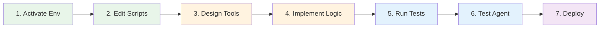

# Agent-First Development Workflow

Quick reference guide for agent-first development in this project.

## How Tool Calls Work (VoiceLive Function Calling)

The Foundry Agent and the relay communicate over a single WebSocket using the
[Azure OpenAI Realtime function-calling protocol](https://learn.microsoft.com/azure/ai-foundry/openai/realtime-audio-reference).
**There are no HTTP callback URLs** — tools execute in-process inside the relay.

```text
Agent decides to call a tool
  ↓ (over WebSocket)
response.output_item.added           → relay/client records call_id → fn name
response.function_call_arguments.done → relay/client parses JSON arguments
  ↓
relay/client dispatches to executor (execute_get_menu_items / execute_submit_order)
  ↓
relay/client sends back:
  conversation.item.create  { item: { type: function_call_output, call_id, output } }
  (VoiceLive automatically resumes the agent run and triggers the next response)
```

Implementation lives in `src/backend/relay.py` and `src/agents/voice_agent_validation.py`:

- `_dispatch_tool(name, arguments, session_id)` — routes the call
- `handle_function_call(...)` — parses arguments, dispatches, and sends the function call output back

To add a new tool:
1. Add the `FunctionTool` definition + `execute_*` function in `src/agent_tools/`
2. Export both from `src/agent_tools/__init__.py` (and append to `ALL_TOOLS`)
3. Add a branch in `_dispatch_tool` so the relay can route the call
4. Re-run `python -m src.agents.create_voice_agent` to push the updated tool schema

## Daily Development Cycle



## Commands

### Environment Setup
```powershell
# Create virtual environment (first time)
uv venv

# Activate virtual environment
.venv\Scripts\Activate.ps1

# Create or update the DriveThru agent in Azure AI Foundry
python -m src.agents.create_voice_agent

# Install new dependencies (ultra-fast with uv)
uv pip install package-name

# Update project dependencies
uv pip install -e .
```

### Agent Development
```powershell
# Create or update the DriveThru agent in Azure AI Foundry
python -m src.agents.create_voice_agent

# Validate agent with voice (microphone + speakers required)
python -m src.agents.voice_agent_validation

# Run automated tests (unit + integration, no Azure credentials needed)
pytest tests/unit tests/integration -v -m "not e2e"

# Deploy agent (alias for create_voice_agent)
python -m src.agents.create_voice_agent
```

### Database Operations
```powershell
# Run schema setup in Fabric SQL editor or via setup script
python platform/fabric/setup_fabric.py

# Seed menu and customer demo data
python -m src.fabric.seed_demo_data
```

## Workflow Steps

### 1. Design Agent Tool

**File:** `src/agent_tools/your_tool.py`

```python
from azure.ai.projects.models import FunctionTool

# Define tool schema
your_tool = FunctionTool(
    name="tool_name",
    description="Clear description of what tool does",
    parameters={
        "type": "object",
        "properties": {
            "param_name": {
                "type": "string",
                "description": "Parameter description"
            }
        },
        "required": ["param_name"]
    }
)
```

### 2. Implement Tool Logic

```python
def execute_tool(params: dict) -> dict:
    """
    Execute the tool logic.
    
    Args:
        params: Tool parameters from agent
        
    Returns:
        Result dictionary with success/data/error
    """
    try:
        # Tool implementation
        result = process_params(params)
        
        return {
            "success": True,
            "data": result
        }
    except Exception as e:
        return {
            "success": False,
            "error": str(e)
        }
```

### 3. Test Tool Independently

**In Jupyter Notebook:**

```python
# Import tool
from src.agent_tools.your_tool import execute_tool

# Test with mock data
result = execute_tool({
    "param_name": "test_value"
})

print(result)
assert result["success"] == True
```

### 4. Integrate with Fabric Database

```python
from src.fabric.db_client import FabricDBClient

def execute_tool(params: dict) -> dict:
    """Tool with database integration."""
    
    # Connect to Fabric DB
    db = FabricDBClient(connection_string)
    
    # Perform database operation
    data = db.query_data(params)
    
    return {
        "success": True,
        "data": data
    }
```

### 5. Test with Agent

**In Jupyter Notebook:**

```python
from azure.ai.projects import AIProjectClient
from azure.identity import DefaultAzureCredential

# Initialize client
client = AIProjectClient(
    endpoint=os.getenv("AZURE_FOUNDRY_ENDPOINT"),
    credential=DefaultAzureCredential(),
    project_name=os.getenv("AZURE_FOUNDRY_PROJECT_NAME")
)

# Create thread
thread = client.agents.create_thread()

# Test conversation
response = client.agents.create_message(
    agent_id=os.getenv("ORDER_AGENT_ID"),
    thread_id=thread.id,
    content="Test message that triggers your tool"
)

print(response.content[0].text.value)
```

### 6. Deploy to Azure Foundry

```python
# Update agent with new tool
updated_agent = client.agents.update_agent(
    agent_id=os.getenv("ORDER_AGENT_ID"),
    tools=[existing_tool_1, existing_tool_2, your_new_tool],
    instructions=updated_instructions
)

print(f"Agent updated: {updated_agent.id}")
```

## Testing Checklist

Before deploying an agent, verify:

- [ ] Tool schema is well-defined with clear descriptions
- [ ] Tool logic handles all parameter variations
- [ ] Error handling returns meaningful messages
- [ ] Database queries use parameterized SQL
- [ ] Tool tested independently with mock data
- [ ] Tool tested with real Fabric Database
- [ ] Agent conversation includes tool correctly
- [ ] Agent provides appropriate responses
- [ ] Order successfully writes to Fabric DB
- [ ] Agent maintains conversation context

## Common Tasks

### Add a New Menu Item

1. Insert into Fabric Database:
```sql
INSERT INTO Menu (MenuItemId, ItemName, Category, Description, Price, IsAvailable)
VALUES ('BURGER_001', 'Classic Burger', 'burgers', 'Our signature burger', 8.99, 1);
```

2. Test menu query tool:
```python
from src.agent_tools.menu_tools import get_menu_items
items = get_menu_items(category="burgers")
assert 'BURGER_001' in [i['menu_item_id'] for i in items]
```

### Test Order Submission

```python
# In Jupyter notebook
from src.agent_tools.order_tools import submit_order

test_order = submit_order({
    "items": [
        {"menu_item_id": "BURGER_001", "quantity": 2},
        {"menu_item_id": "DRINK_001", "quantity": 1}
    ],
    "customer_id": "test_customer"
})

print(f"Order ID: {test_order['order_id']}")
print(f"Total: ${test_order['total']}")
```

### Query Order Analytics

```python
# Test analytics agent
from src.agent_tools.analytics_tools import get_analytics

popular = get_analytics({
    "metric": "popular_items",
    "time_period": "today"
})

print(f"Top items: {popular['items']}")
```

## Debugging Tips

### Agent Not Using Tool

**Check:**
1. Tool is registered with agent
2. Tool description is clear
3. Parameters match expected format
4. Agent instructions mention tool usage

```python
# Verify tool registration
agent = client.agents.get_agent(agent_id)
print("Registered tools:", [t.function.name for t in agent.tools])
```

### Database Connection Fails

**Check:**
1. Connection string is correct
2. Firewall allows connection
3. Credentials are valid
4. Database exists

```python
# Test connection
import pyodbc
try:
    conn = pyodbc.connect(connection_string)
    print("Connection successful!")
    conn.close()
except Exception as e:
    print(f"Connection failed: {e}")
```

### Tool Returns Error

**Check:**
1. Parameters are validated
2. Error handling is implemented
3. Logs show detailed error
4. Database transactions commit

```python
# Add logging
import logging
logging.basicConfig(level=logging.DEBUG)
logger = logging.getLogger(__name__)

def execute_tool(params):
    logger.debug(f"Tool called with params: {params}")
    # ... tool logic
```

## Environment Variables

Required for agent development (see `.env.example`):

```bash
# .env file
PROJECT_ENDPOINT="https://aif-voiceliveapi-demo.services.ai.azure.com/api/projects/proj-voiceliveapi-demo"
PROJECT_NAME="proj-voiceliveapi-demo"
VOICELIVE_ENDPOINT="https://aif-voiceliveapi-demo.services.ai.azure.com/"
AGENT_NAME="drivethru-ordering-agent"
MODEL_DEPLOYMENT_NAME="gpt-4o-realtime-preview"
FABRIC_CONNECTION_STRING="Driver={ODBC Driver 18 for SQL Server};Server=your-server.datawarehouse.fabric.microsoft.com;Database=DriveThru;Encrypt=yes;Authentication=ActiveDirectoryInteractive"
```

## Resources

- [README.md](../README.md) — Main repository setup & architecture
- [Azure AI Foundry Docs](https://learn.microsoft.com/azure/ai-foundry/)
- [Microsoft Fabric Docs](https://learn.microsoft.com/fabric/)

---

**Remember: Test tools independently, seed Fabric DB, then validate with voice!** 🚀
